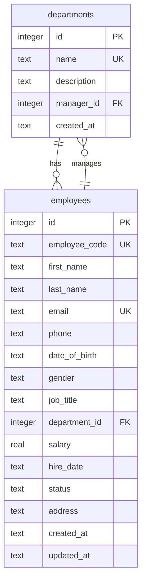

# Auspify EMS — Employee Management System

A full-stack employee management system built with **Python + Flask**,
**React + Vite**, and **SQLite**. It manages employee records, departments,
search and filters, reports, and CSV exports.

> **Status: Steps 0–5 complete.** The application starts with an empty
> database (no demo or seed data), includes full CRUD with validation,
> search/filter/pagination, five report endpoints with CSV exports, a
> 10,000-employee performance benchmark, and a 59-test pytest suite.

---

## 1. Features

- **Dashboard** — headcount, active/on-leave counts, total payroll, average
  salary, headcount and status charts, and recent hires.
- **Employee records** — registration, details, edit, soft delete
  (terminate), and confirmed hard delete.
- **Departments** — create, edit, assign a manager, and delete (blocked while
  employees are assigned).
- **Search and filters** — partial, case-insensitive search by name, email, or
  employee code; filter by department, status, job title, and hire-date range;
  sort and paginate.
- **Reports** — headcount by department, salary summary, new hires, status
  breakdown, and employee directory.
- **CSV exports** — headcount, salary summary, and employee directory.
- **Responsive UI** — desktop and mobile layouts, shared navbar, confirmation
  dialogs, and toast notifications.
- **Performance work** — composite indexes, WAL mode, explicit column
  selection, pagination, a short-lived report cache, debounced search,
  memoized table, and lazy-loaded routes.

## 2. Tech stack

| Layer | Technology |
|-------|------------|
| Backend | Python 3.11, Flask 3.1, flask-cors, sqlite3 |
| Frontend | React 19, Vite 8, React Router 7, Recharts 3, plain CSS |
| Database | SQLite (WAL mode, foreign keys enabled) |
| Testing | pytest |
| Build | Vite production build |

## 3. Folder structure

```text
auspify_ems/
├── backend/
│   ├── app.py                  # App factory, health, error handlers
│   ├── database.py             # Schema, indexes, WAL
│   ├── validation.py           # Server-side validation
│   ├── performance.py          # Report cache + invalidation
│   ├── seed_large.py           # 10,000+ employee generator
│   ├── benchmark.py            # Before/after timings + query plans
│   ├── requirements.txt
│   ├── requirements-dev.txt
│   ├── pytest.ini
│   ├── routes/
│   │   ├── employees.py
│   │   ├── departments.py
│   │   └── reports.py
│   └── tests/
│       ├── conftest.py
│       ├── test_health.py
│       ├── test_employees.py
│       ├── test_departments.py
│       └── test_reports.py
├── frontend/
│   ├── src/
│   │   ├── App.jsx             # Router, lazy routes, layout
│   │   ├── api.js              # fetch wrapper
│   │   ├── index.css           # Design system
│   │   ├── components/         # Navbar, table, search, dialog, toast, spinner
│   │   ├── context/            # Notification provider
│   │   ├── hooks/              # useDebounce, useNotification
│   │   └── pages/              # Dashboard, Employees, Form, Details, Departments, Reports
│   └── vite.config.js          # /api proxy -> Flask
├── docs/
│   ├── REQUIREMENTS.md
│   ├── WIREFRAMES.md
│   ├── FOLDER_STRUCTURE.md
│   ├── PERFORMANCE.md
│   └── TESTING.md
└── README.md
```

## 4. Setup

### Requirements

- Python 3.11+
- Node.js 20+ and npm

### Backend

From the repository root:

```bash
python3 -m venv .venv
source .venv/bin/activate          # Windows: .venv\Scripts\activate
pip install -r backend/requirements.txt
pip install -r backend/requirements-dev.txt   # for pytest
```

### Frontend

```bash
cd frontend
npm install
```

## 5. Run

You need **two terminals**.

**Terminal 1 — Flask API:**

```bash
cd backend
../.venv/bin/python app.py
```

The API starts on <http://127.0.0.1:5000>. The SQLite database is created at
`backend/ems.db` on first run. It starts empty; add departments and employees
through the UI.

**Terminal 2 — React dev server:**

```bash
cd frontend
npm run dev
```

Vite starts on <http://127.0.0.1:5173> and proxies `/api` to Flask.

Open <http://127.0.0.1:5173>.

### Optional: use a different database

```bash
EMS_DB_PATH=/tmp/ems.db ../.venv/bin/python app.py
```

## 6. Database and ER diagram

The schema is created automatically on first run. The application starts with no
records; there is no demo or seed data. Foreign keys are enabled on every
connection and the database uses WAL mode.



`departments.manager_id` and `employees.department_id` reference each other.
`manager_id` is nullable and uses `ON DELETE SET NULL`; `department_id` is
required and uses `ON DELETE RESTRICT`.

Indexes:

- `idx_employees_employee_code`
- `idx_employees_email`
- `idx_employees_last_name`
- `idx_employees_department_id`
- `idx_employees_status`
- `idx_employees_status_department` (composite, added after profiling)
- `idx_employees_department_status` (composite, added after profiling)
- `idx_employees_hire_date` (added after profiling)

## 7. API reference

Base URL: `/api`. All responses are JSON unless `format=csv` is specified.

### Health

| Method | Endpoint | Description |
|--------|----------|-------------|
| GET | `/api/health` | Service status, version, database check, timestamp |

### Employees

| Method | Endpoint | Description | Status codes |
|--------|----------|-------------|--------------|
| GET | `/api/employees` | List/search/filter/sort/paginate | 200, 400 |
| GET | `/api/employees/<id>` | Employee detail | 200, 404 |
| POST | `/api/employees` | Create employee (auto code if omitted) | 201, 400, 409 |
| PUT | `/api/employees/<id>` | Update employee | 200, 400, 404, 409 |
| DELETE | `/api/employees/<id>` | Soft delete (terminate) | 200, 404 |
| DELETE | `/api/employees/<id>?hard=true` | Permanent delete | 200, 404 |

**`GET /api/employees` query parameters**

| Parameter | Description |
|-----------|-------------|
| `search` | Partial, case-insensitive match on first name, last name, email, or employee code |
| `department` | Department ID or name |
| `status` | `active`, `on_leave`, or `terminated` |
| `job_title` | Partial, case-insensitive job title |
| `hired_from` / `hired_to` | Inclusive `YYYY-MM-DD` hire-date range |
| `sort` | `first_name`, `last_name`, `email`, `employee_code`, `hire_date`, `salary`, `status`, `department`, `created_at` |
| `order` | `asc` or `desc` |
| `page` / `per_page` | Pagination (default 1 / 25, maximum 100) |
| `include_terminated` | `true` to include terminated employees (default: hidden) |

Response:

```json
{
  "data": [
    {
      "id": 1,
      "employee_code": "EMP-0001",
      "first_name": "Kwame",
      "last_name": "Mensah",
      "email": "kwame.mensah@auspify.com",
      "job_title": "Engineering Manager",
      "department_id": 1,
      "department_name": "Engineering",
      "salary": 145000,
      "hire_date": "2018-02-01",
      "status": "active"
    }
  ],
  "meta": {
    "total": 25,
    "page": 1,
    "per_page": 25,
    "total_pages": 1,
    "returned": 25,
    "sort": "last_name",
    "order": "asc"
  }
}
```

### Departments

| Method | Endpoint | Description | Status codes |
|--------|----------|-------------|--------------|
| GET | `/api/departments` | List with manager and employee counts | 200 |
| GET | `/api/departments/<id>` | Department detail | 200, 404 |
| POST | `/api/departments` | Create department | 201, 400, 409 |
| PUT | `/api/departments/<id>` | Update department | 200, 400, 404, 409 |
| DELETE | `/api/departments/<id>` | Delete empty department | 200, 404, 409 |

### Reports

| Method | Endpoint | Description |
|--------|----------|-------------|
| GET | `/api/reports/headcount-by-department` | Headcount and status counts per department (`?format=csv`) |
| GET | `/api/reports/salary-summary` | Min/max/average/total salary per department (`?format=csv`) |
| GET | `/api/reports/new-hires?from=&to=` | Employees hired in a date range |
| GET | `/api/reports/status-breakdown` | Counts per status |
| GET | `/api/reports/employee-directory` | Current employees (`?include_terminated=true`, `?format=csv`) |

Report responses include `data` and `meta`. CSV responses use
`Content-Type: text/csv` and a `Content-Disposition` attachment header.

## 8. Testing

```bash
cd backend
../.venv/bin/python -m pytest
```

Latest result: **59 passed**. The suite covers validation, CRUD, soft/hard
delete, department rules, filters, pagination, reports, CSV exports, cache
invalidation, empty database, foreign keys, and WAL mode.

See [docs/TESTING.md](docs/TESTING.md) for the full coverage table, manual
end-to-end checklist, edge cases, and known limitations.

Frontend checks:

```bash
cd frontend
npm run lint
npm run build
```

Both pass with 0 warnings/errors.

## 9. Performance

A reproducible benchmark generates 10,000 employees in a separate temporary
database and measures the employee
list, search, filters, initial dashboard data, and every report endpoint.
It then applies composite indexes, WAL mode, and report caching and measures
again. The full report, including `EXPLAIN QUERY PLAN` output, is in
[docs/PERFORMANCE.md](docs/PERFORMANCE.md).

Latest results (median of 100 requests, 10,000 employees):

| Endpoint | Before (ms) | After (ms) | Change |
|----------|------------:|-----------:|-------:|
| Employee list (page 1) | 1.27 | 1.52 | +19.7% |
| Search (partial, case-insensitive) | 10.09 | 10.51 | +4.2% |
| Filter (department + status) | 2.58 | 2.10 | -18.6% |
| Initial dashboard data | 1.02 | 1.35 | +32.4% |
| Headcount by department | 6.38 | 0.22 | -96.6% |
| Salary summary | 6.72 | 0.23 | -96.6% |
| New hires (date range) | 20.43 | 7.87 | -61.5% |
| Status breakdown | 0.98 | 0.22 | -77.6% |
| Employee directory | 58.67 | 23.55 | -59.9% |

The slowest endpoints improved substantially: the employee directory is
**~60% faster**, new hires **~62% faster**, and the cached reports are
**~78–97% faster**. The filter query now uses the composite
`idx_employees_department_status` index. The list and initial dashboard
requests are already under 2 ms; their small differences are within
run-to-run noise, and WAL mode adds a tiny overhead to very small read-only
requests while improving write concurrency.

Reproduce:

```bash
cd backend
../.venv/bin/python benchmark.py --employees 10000 --runs 100 --reset
```

Generate a large development database:

```bash
cd backend
../.venv/bin/python seed_large.py --db ems_large.db --employees 10000 --reset --indexes
```

## 10. Suggested improvements

1. **Authentication and roles** — session/JWT login, admin vs HR permissions.
2. **Leave management** — leave requests, approvals, balances, and calendars.
3. **Payroll** — payslips, taxes, benefits, and payroll runs.
4. **Profile photos** — upload, storage, and image resizing.
5. **Audit log** — record who changed which employee or department and when.
6. **Docker** — Dockerfile and Compose for Flask + gunicorn + SQLite volume.
7. **Full-text search** — SQLite FTS5 for very large or multi-word searches.
8. **Production server** — gunicorn/Waitress behind Nginx instead of the Flask
   development server.
9. **Frontend tests** — Vitest + React Testing Library for components and forms.
10. **CSV import** — bulk employee import with validation and error reporting.

## 11. Step completion summary

| Step | Scope | Status |
|------|-------|--------|
| 0 | Project setup, requirements, health endpoint, React/Vite app, proxy | Complete |
| 1 | SQLite schema, screens, shared components | Complete |
| 2 | Employee registration, validation, auto code, department creation | Complete |
| 3 | Update, soft/hard delete, department rules, confirmations | Complete |
| 4 | Search, filters, pagination, reports, charts, CSV exports | Complete |
| 5 | 10k benchmark, indexes, WAL, cache, lazy loading, pytest, docs | Complete |

All 58 backend tests pass, the frontend builds and lints cleanly, and the
manual end-to-end checklist is in [docs/TESTING.md](docs/TESTING.md).
